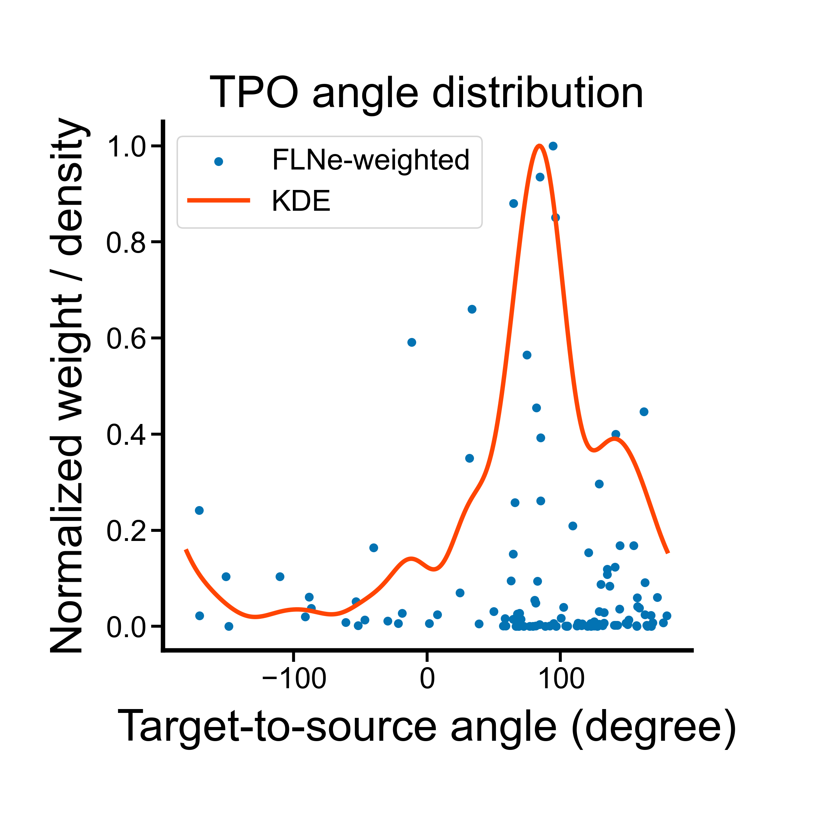
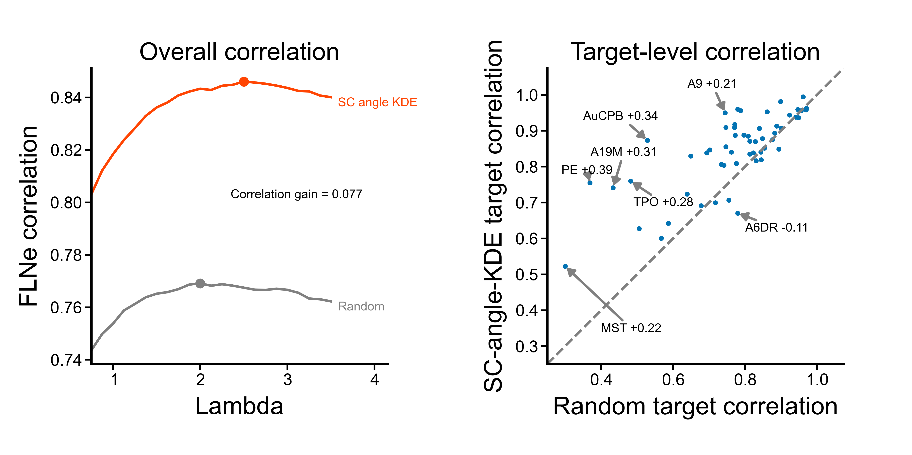

# Marmoset 目标条件角度分布对标

## 1. 角度分布与连接生成

对每个目标脑区，用二维皮层上各分片的质心计算“目标到源头”的角度，并以实测 FLNe 分配后的权重构建角度分布；随后用带宽为 15° 的 von Mises 核进行圆周平滑，得到该目标脑区特异的角度分布。

von Mises 核类似于圆周上的高斯核，其概率密度正比于 `exp(kappa * cos(theta - mu))`，在中点角度 `mu` 附近最高，并将 -180° 和 180° 视为相邻方向。实验以 `sigma=15°` 作为近似角宽，换算为弧度后令 `kappa = 1 / sigma^2 ≈ 14.59`；各来源脑区对应的核归一化后，按 FLNe 加权求和得到角度概率密度。

对 `V2--1`、`V2--2` 这类属于同一脑区的分片，按分片面积占该脑区总面积的比例分配权重。源分片 `i` 和目标分片 `j` 的角度权重为 `FLNe × p_source[i] × p_target[j]`；所有分片对的权重之和仍等于原 FLNe。未分片脑区的比例恒为 1，不按其面积缩放 FLNe。每个目标脑区使用包含全部源、目标分片对的混合角度分布。质心用于确定角度，不保证位于分片内部。

生成连接时，目标点按分片面积比例选择分片后在其内部均匀采样；源头点落入任一分片均归回所属脑区，同一脑区不同分片之间的连接仍作为自连接排除。

每条连接按以下顺序生成：

1. 在目标脑区内采样目标点；
2. 从均匀角度分布（`random`）或目标脑区特异角度分布（`SC_angle_kde`）采样方向 `theta`；
3. 按 `d ~ Exponential(Lambda)` 采样距离；
4. 计算 `source = target + d * [cos(theta), sin(theta)]`，并识别源头点所属脑区。

正式扫描每个目标脑区生成 20,000 条连接，使用 `Lambda=0.75:0.125:3.5`、`max_iteration=10` 和 `the_seed=20261026`。

TPO 的 104 个非零 FLNe 来源形成以下角度分布。散点表示各分片对的角度及分配后的相对 FLNe 权重，曲线表示核平滑结果；两者分别除以自身最大值，仅用于对照分布形状。

## 2. 相对原始 EDR 的相关性提升

按各自最优 `Lambda` 比较，均匀角度 EDR 的总体 FLNe correlation 为 `0.7691`（`Lambda=2.0`），目标条件角度模型为 `0.8460`（`Lambda=2.5`），绝对提升 `0.0769`。55 个目标脑区中有 41 个得到提升。

总体相关性随 `Lambda` 的变化及逐脑区对比如下。逐脑区图中，每个散点对应一个目标脑区，位于对角线上方表示相关性提升；文字列出代表脑区的名称及相关性差值，并以箭头指向对应散点。

提升最大的脑区如下：

| 目标脑区 | Correlation 提升 |
|---|---:|
| PE | +0.386 |
| AuCPB | +0.344 |
| A19M | +0.308 |
| TPO | +0.278 |
| MST | +0.222 |
| A9 | +0.205 |
| TE3 | +0.181 |
| A11 | +0.180 |
| A24d | +0.168 |
| V4T | +0.162 |

全部脑区结果见 `results/experiments/marmoset_target_conditioned_angle_edr/optimal_target_comparison.csv`。
